# OpenPSP — Payment Orchestrator

An open-source payment orchestrator built to answer one question under failure:

> **When the PSP times out, a callback is lost, or Kafka redelivers, does money get lost or counted twice?**

The design goal is that it doesn't. A payment flows from an idempotent REST API, through an explicit state machine and a resilient PSP adapter, into a transactional outbox, over Kafka, and into a double-entry ledger whose invariants are enforced by the database itself.

   

---

## Table of contents

1. [Status — what works today](#status--what-works-today)
2. [Architecture](#architecture)
3. [The money path](#the-money-path)
4. [Payment state machine](#payment-state-machine)
5. [Domain model (UML)](#domain-model-uml)
6. [Data model](#data-model)
7. [Guarantees and how each one is proven](#guarantees-and-how-each-one-is-proven)
8. [Resilience and timeout budget](#resilience-and-timeout-budget)
9. [Getting started](#getting-started)
10. [Testing](#testing)
11. [Project layout](#project-layout)
12. [Architecture Decision Records](#architecture-decision-records)
13. [Known limitations](#known-limitations)

---

## Status — what works today

This project is in progress. The table is kept honest: a component is ✅ only when it is implemented **and** covered by a test that runs in CI.

| Component | Status | Notes |
|---|---|---|
| Payment aggregate + state machine | ✅ | Framework-free domain module; illegal transitions throw |
| Idempotent `POST /payments` (key + SHA-256 body hash, 409 on mismatch) | 🚧 | Store logic tested; HTTP binding of `merchantId` is being fixed |
| Optimistic locking (`@Version`) | ✅ | Concurrent-thread test |
| PSP adapter — retry, circuit breaker, time limiter | 🚧 | Implemented; not yet called from the create flow; backoff config being corrected |
| HMAC-verified PSP callbacks + Redis replay guard | ✅ / 🚧 | Verified & tested; ordering of replay-mark vs processing being fixed |
| Reconciler for payments stuck in `PENDING_PSP` | ✅ / 🚧 | Tested in isolation; becomes live once the PSP call is wired |
| Transactional outbox → Kafka publisher | 🚧 | Publisher done (`acks=all`, idempotent producer, `SKIP LOCKED`); writing the outbox row in the state-change transaction is in progress |
| Double-entry ledger (DB-enforced balance, append-only) | ✅ | Deferred constraint triggers; redelivery test with a crashed consumer |
| End-to-end failure-injection test | 🚧 | In progress |

---

## Architecture

### System context

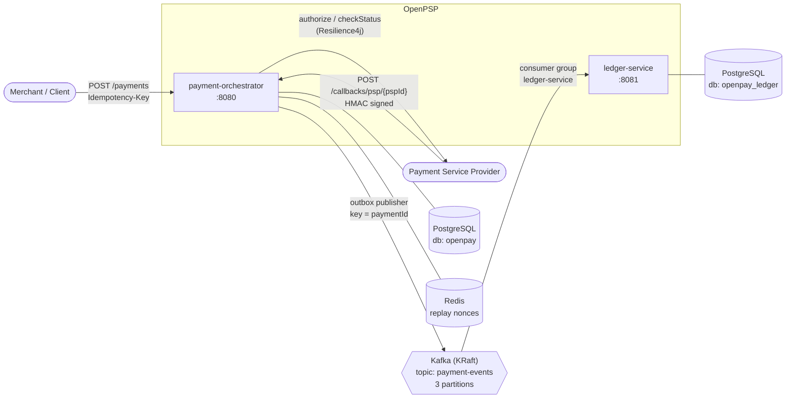

Two services, two databases, one event stream. The orchestrator owns the payment lifecycle; the ledger owns money movement. They share nothing but the `PaymentSettled.v1` event contract. See [ADR index](docs/adr/README.md) for why the boundary sits there.

### Hexagonal module structure

Each service is split into four Gradle modules. Dependencies point inward only; the domain has zero framework dependencies (verifiable with `./gradlew :payment-orchestrator:domain:dependencies`).

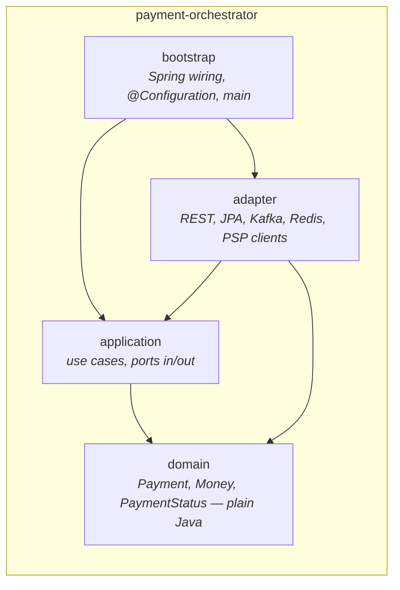

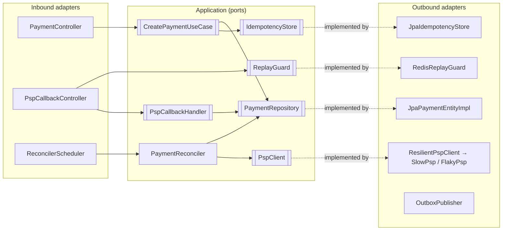

---

## The money path

### Happy path (target flow)

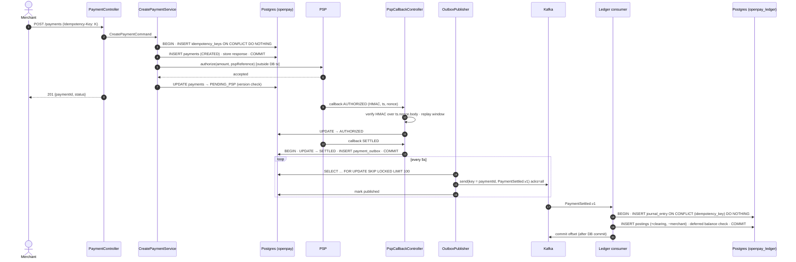

### Failure path — PSP times out, callback never arrives

"No answer" is treated as **unknown**, never as **failed**. The reconciler resolves it by asking the PSP.

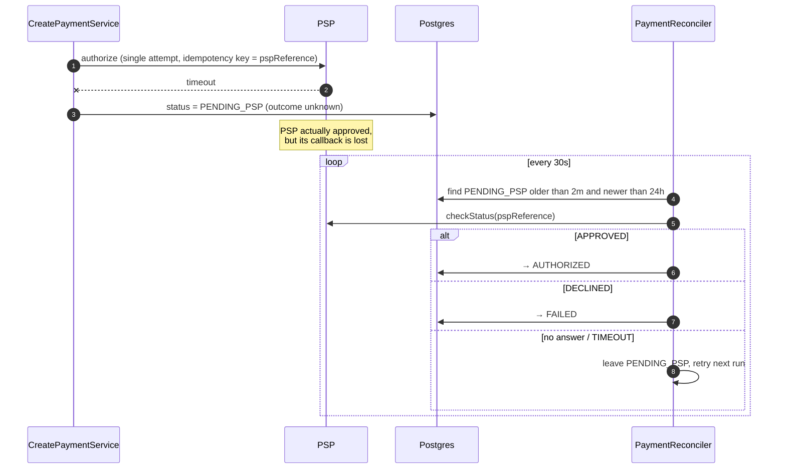

Worst-case detection window: `stuck-threshold + poll-interval = 2m + 30s = 150s` ([ADR-0006](docs/adr/0006-reconciler-polling-design.md)).

### Failure path — Kafka redelivery

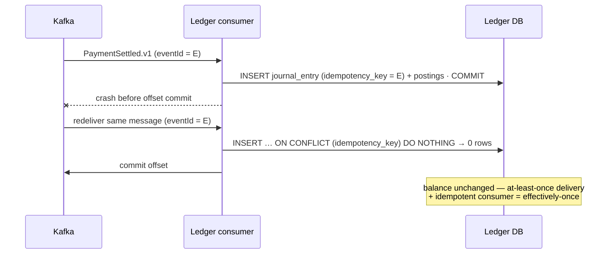

---

## Payment state machine

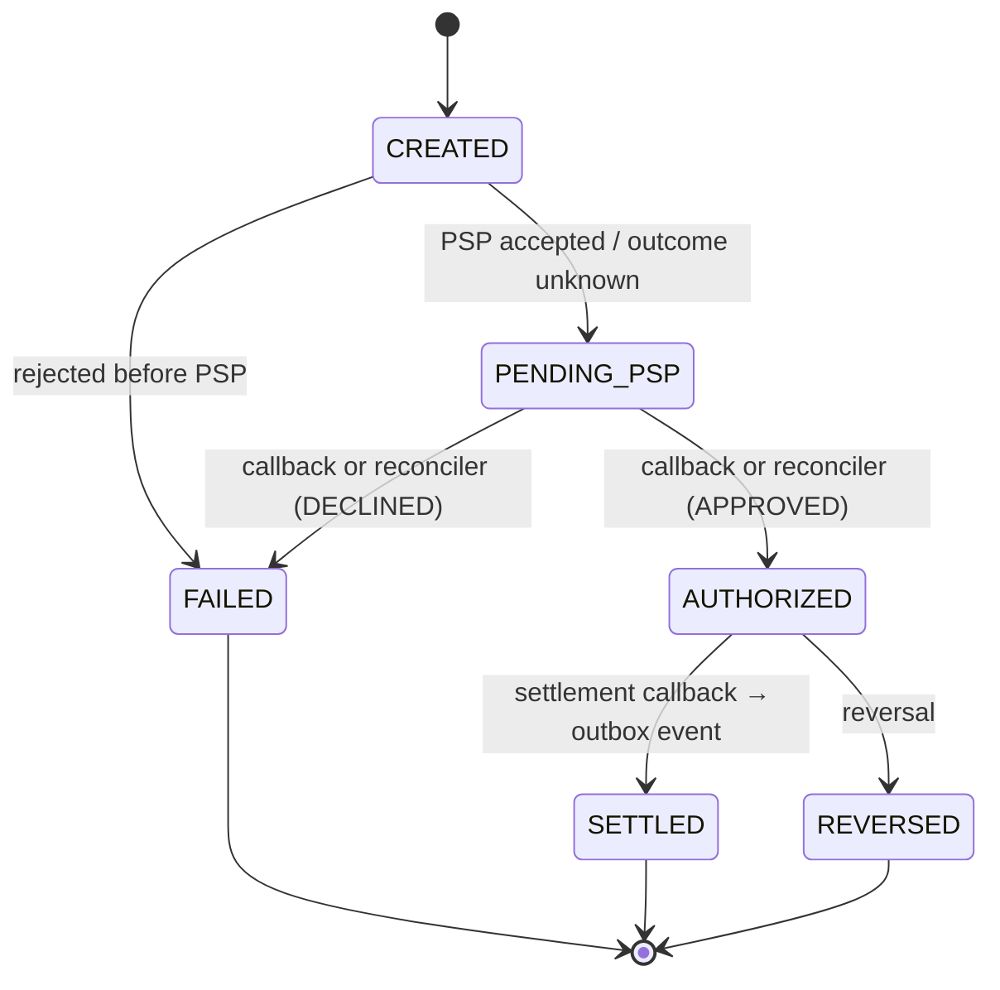

Transitions live in one place (`PaymentStatus`) and are the only way to change state (`Payment.authorize()`, `settle()`, …). There are no setters. A **stale** callback (e.g. `AUTHORIZED` arriving after `SETTLED`) is a no-op. See [ADR-0001](docs/adr/0001-payment-state-machine.md).

---

## Domain model (UML)

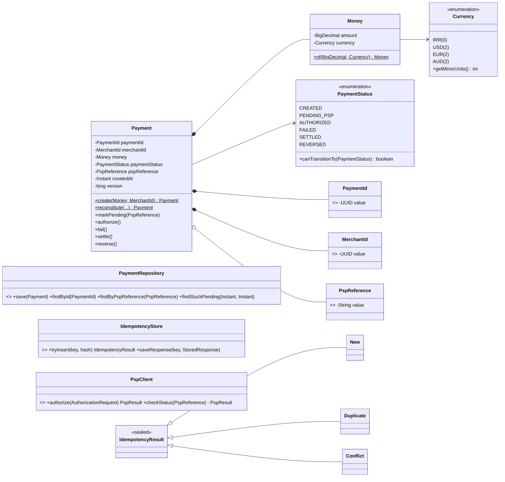

Ledger domain:

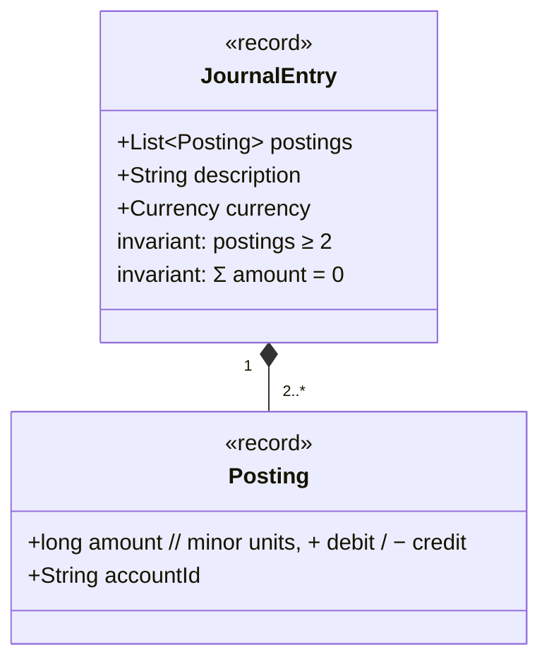

---

## Data model

### Orchestrator (`openpay`)

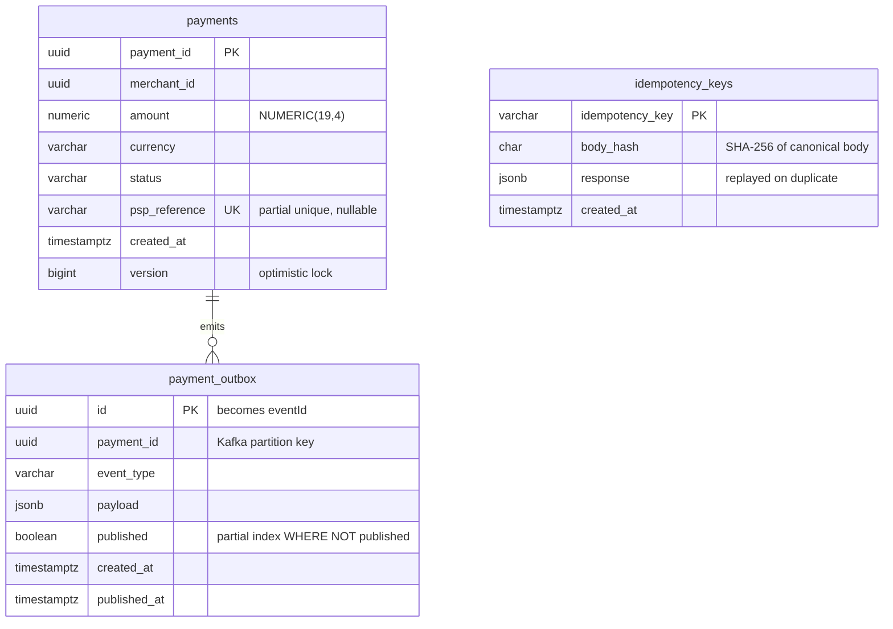

### Ledger (`openpay_ledger`)

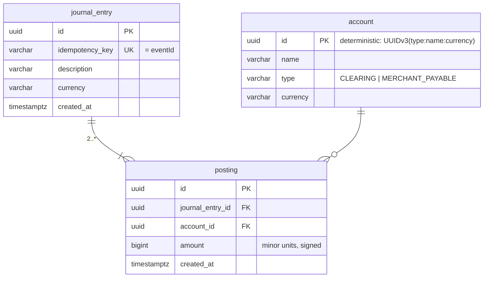

Enforced **in PostgreSQL**, not only in Java:

| Invariant | Mechanism |
|---|---|
| Every entry has ≥ 2 postings and sums to 0 | `DEFERRABLE INITIALLY DEFERRED` constraint triggers on `posting` and `journal_entry`, checked at commit |
| Ledger is append-only | `BEFORE UPDATE OR DELETE` triggers reject any mutation of `account`, `journal_entry`, `posting` |
| One entry per event | `UNIQUE (idempotency_key)` + `ON CONFLICT DO NOTHING` |
| No floating point money | `BIGINT` minor units on the wire and in the ledger |

### Settlement posting

For `PaymentSettled.v1` of 10,000 minor units:

| Account | Type | Amount |
|---|---|---|
| `psp_clearing` | CLEARING | **+10,000** (debit — money receivable from PSP) |
| `merchant:{merchantId}` | MERCHANT_PAYABLE | **−10,000** (credit — money owed to merchant) |
| | **Σ** | **0** |

### Event contract — `PaymentSettled.v1`

Schema lives in [`docs/events/PaymentSettled.v1.json`](docs/events/PaymentSettled.v1.json). The version is part of `eventType`; consumers reject unknown types.

```json
{
  "eventId": "33333333-3333-3333-3333-333333333333",
  "eventType": "PaymentSettled.v1",
  "data": {
    "paymentId": "11111111-1111-1111-1111-111111111111",
    "merchantId": "22222222-2222-2222-2222-222222222222",
    "amountMinor": 10000,
    "currency": "IRR",
    "settledAt": "2026-09-21T10:00:00Z"
  }
}
```

---

## Guarantees and how each one is proven

| Failure | Mechanism | Proof |
|---|---|---|
| Client retries `POST /payments` | Idempotency key + body hash; stored response replayed | `CreatePaymentService` + `JpaIdempotencyStore` |
| Same key, different body | `409 Conflict` | idempotency store tests |
| Two writers update the same payment | `@Version` optimistic lock — exactly one wins | `PaymentEntityConcurrencyTest` |
| Illegal state change (e.g. `SETTLED → PENDING_PSP`) | Transition table in `PaymentStatus` | `PaymentTest` |
| Forged callback | HMAC-SHA256 over `timestamp.nonce.rawBody`, constant-time compare | `HmacVerifierTest` |
| Replayed callback | ±5 min window + Redis `SET NX` nonce | `RedisReplayGuardTest` |
| Same callback delivered 3× | State machine no-ops on already-applied status | `PspCallbackServiceTest` |
| Callback lost | Reconciler polls PSP for stuck `PENDING_PSP` | `PaymentReconcilerTest` |
| PSP down | Circuit breaker opens, fails fast | `ResilientPspClientTest` |
| Kafka redelivers a settled event | Unique `idempotency_key` in ledger | `LedgerKafkaRedeliveryTest` (consumer killed between DB commit and offset commit) |
| Buggy code writes an unbalanced entry | Deferred DB trigger rolls back the transaction | `LedgerRepositoryTest` |
| Crash between state change and publish | Transactional outbox | 🚧 in progress |
| All of the above, end to end | Testcontainers + PSP fault injection | 🚧 in progress |

Delivery semantics are **at-least-once everywhere, with idempotent receivers**. Nothing in this system claims exactly-once.

---

## Resilience and timeout budget

`ResilientPspClient` decorates every PSP call as `Retry( CircuitBreaker( TimeLimiter( call ) ) )`, so each retry attempt passes through the breaker and is individually time-limited ([ADR-0004](docs/adr/0004-resilience4j-programmatic-decorator.md)).

| Setting | Value |
|---|---|
| Time limit per attempt | 500 ms |
| Retry attempts | 5 (not retried on `PspClientException` — 4xx-class errors) |
| Circuit breaker | count-based window 10, opens at 50 % failures, 10 s open, 10 calls half-open |
| Reconciler | every 30 s; candidates older than 2 m, younger than 24 h |

**Timeout budget (end-to-end SLA 3 s)** — target values; the resilience config is being aligned with this table:

| Layer | Budget |
|---|---|
| Ingress + validation + idempotency insert | 150 ms |
| DB transaction (create) | 150 ms |
| PSP authorize — **single attempt**, no retry | 2,000 ms |
| DB update to `PENDING_PSP` | 150 ms |
| Headroom | 550 ms |

`authorize` must not be retried blindly: a timeout means *unknown*, and a retry without a PSP-side idempotency key can charge twice. `checkStatus` is a read, so retries are safe there.

---

## Getting started

### Prerequisites

- JDK 21
- Docker with Compose v2

### Run the infrastructure

```bash
docker compose up -d          # postgres:17, redis:7.4, kafka 3.9 (KRaft), topic bootstrap
docker compose ps
```

This creates two databases in one PostgreSQL instance (`openpay`, `openpay_ledger`) and the `payment-events` topic with 3 partitions. Flyway migrates each schema on service start-up.

### Run the services

```bash
./gradlew :payment-orchestrator:bootstrap:bootRun   # :8080
./gradlew :ledger-service:bootstrap:bootRun         # :8081
```

### Try it

> The requests below describe the target behaviour. Until the JSON binding of `merchantId` and the PSP call in the create flow are in place, the create request is rejected and callbacks find no matching payment.

Create a payment:

```bash
curl -i -X POST localhost:8080/payments \
  -H 'Content-Type: application/json' \
  -H 'Idempotency-Key: order-42' \
  -d '{"amount": 100.00, "currency": "USD", "merchantId": "22222222-2222-2222-2222-222222222222"}'
```

Send the same request again: you get the same `paymentId`, and no new row is created. Change the amount with the same key and you get `409 Conflict`.

Send a signed PSP callback:

```bash
SECRET=dev-secret-change-me
TS=$(date +%s)
NONCE=$(uuidgen)
BODY='{"pspReference":"<psp-ref>","status":"AUTHORIZED"}'
SIG=$(printf '%s.%s.%s' "$TS" "$NONCE" "$BODY" | openssl dgst -sha256 -hmac "$SECRET" -hex | awk '{print $2}')

curl -i -X POST localhost:8080/callbacks/psp/slow-psp \
  -H 'Content-Type: application/json' \
  -H "X-Psp-Timestamp: $TS" -H "X-Psp-Nonce: $NONCE" -H "X-Psp-Signature: $SIG" \
  -d "$BODY"
```

Inspect the ledger:

```bash
docker exec -it openpay-postgres psql -U openpay -d openpay_ledger -c \
  "SELECT a.name, SUM(p.amount) AS balance FROM posting p JOIN account a ON a.id = p.account_id GROUP BY a.name;"
```

### Configuration

| Variable | Default | Used by |
|---|---|---|
| `PAYMENT_DB_URL` | `jdbc:postgresql://localhost:5432/openpay` | orchestrator |
| `LEDGER_DB_URL` | `jdbc:postgresql://localhost:5432/openpay_ledger` | ledger |
| `KAFKA_BOOTSTRAP_SERVERS` | `localhost:9092` | both |
| `REDIS_HOST` / `REDIS_PORT` / `REDIS_PASSWORD` | `localhost` / `6379` / `openpay-redis` | orchestrator |
| `SLOW_PSP_SECRET` | `dev-secret-change-me` | callback HMAC |

---

## Testing

```bash
./gradlew build     # unit + integration tests (Testcontainers needs Docker)
```

| Level | What | Tooling |
|---|---|---|
| Domain | State machine, `Money`, `JournalEntry` invariants | JUnit 5, no Spring |
| Application | Callback idempotency, reconciler decisions | JUnit 5 with in-memory ports |
| Adapter | Optimistic locking, idempotency store, HMAC, replay guard, outbox publisher, circuit breaker | Testcontainers (PostgreSQL), Mockito |
| Ledger | DB triggers, redelivery after crash | Testcontainers (PostgreSQL, Kafka) |
| End-to-end | Full money path under PSP timeout + manual event re-injection | 🚧 in progress |

---

## Project layout

```
.
├── payment-orchestrator/
│   ├── domain/          Payment, Money, PaymentStatus — no framework
│   ├── application/     use cases, ports, reconciler, callback service
│   ├── adapter/         REST, JPA, Flyway (V1–V4), Kafka outbox, Redis, PSP clients
│   └── bootstrap/       Spring Boot main + wiring
├── ledger-service/
│   ├── domain/          JournalEntry, Posting
│   ├── application/
│   ├── adapter/         Kafka listener, JDBC ledger repository, Flyway (V1–V4)
│   └── bootstrap/
├── psp-gateway/         placeholder, to be replaced by a PSP stub in the end-to-end tests
├── docs/
│   ├── adr/             Architecture Decision Records
│   └── events/          event contracts
├── docker/postgres/init creates the ledger database
└── docker-compose.yml   postgres, redis, kafka (KRaft), topic init
```

---

## Architecture Decision Records

| ADR | Decision |
|---|---|
| [0001](docs/adr/0001-payment-state-machine.md) | Centralized state machine on the `Payment` aggregate |
| [0002](docs/adr/0002-hexagonal-module-boundaries.md) | Four-module hexagonal split |
| [0003](docs/adr/0003-config-vs-wiring-split.md) | All Spring wiring lives in `bootstrap` |
| [0004](docs/adr/0004-resilience4j-programmatic-decorator.md) | Programmatic Resilience4j decorator, not annotations |
| [0005](docs/adr/0005-hmac-replay-callback-idempotency.md) | HMAC, replay protection and idempotency are three separate concerns |
| [0006](docs/adr/0006-reconciler-polling-design.md) | Reconciler polling — rate, backoff, age cap |
| [0007](docs/adr/0007-in-out-adapter-naming-fix.md) | In/out adapter package naming |
| [0008](docs/adr/0008-wire-minor-units-and-event-envelope.md) | Minor units on the wire and the event envelope |
| [0009](docs/adr/0009-jdbc-ledger-writes-and-deterministic-accounts.md) | JDBC ledger writes and deterministic account ids |
| [0010](docs/adr/0010-append-only-db-enforcement.md) | Append-only ledger enforced in the database |

---

## Known limitations

Listed on purpose.

- The create flow does not call the PSP yet, so payments stay `CREATED` until it does.
- The outbox row is not yet written in the state-change transaction.
- An *early* callback (e.g. `SETTLED` while still `PENDING_PSP`) is acknowledged and dropped instead of being rejected for redelivery.
- The replay nonce is recorded before processing, so a failed processing attempt cannot be retried with the same nonce.
- The ledger consumer has no dead-letter topic; a poison message is logged and skipped after the default retries.
- Idempotency keys are global, not scoped per merchant, and never expire.
- The outbox publisher sends synchronously inside the DB transaction; one failed send re-publishes the whole batch (safe because consumers are idempotent, but wasteful).
- Single PostgreSQL instance hosts both databases for local development; the logical boundary is the database, not the server.

